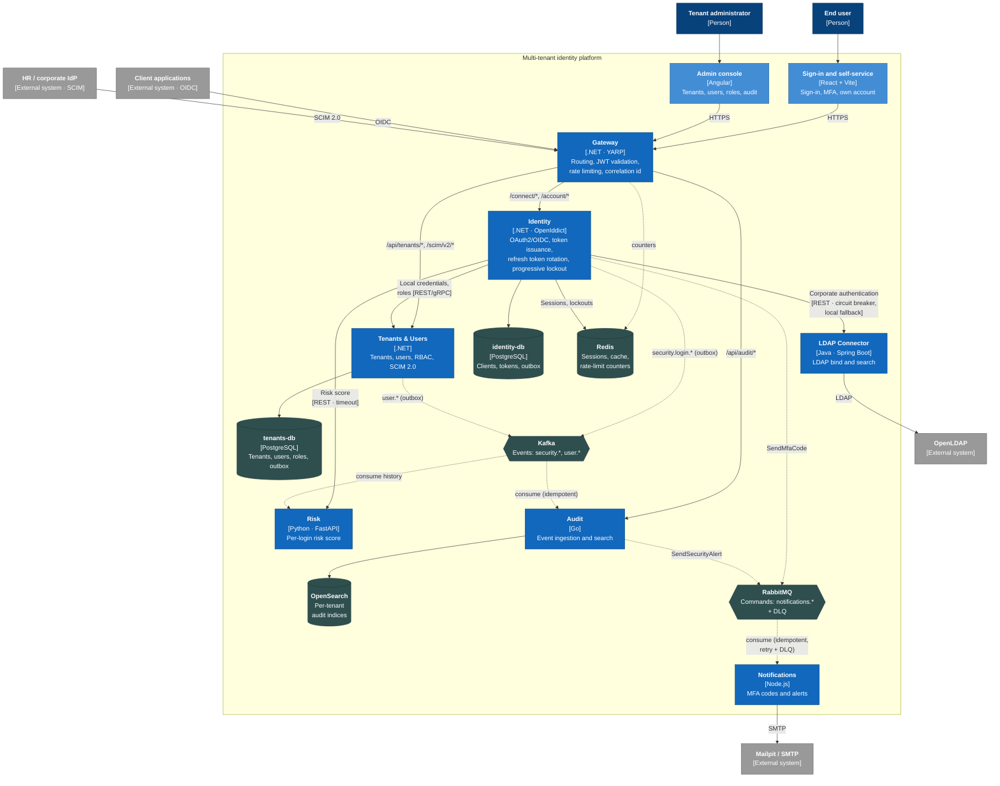

# C4 · Level 2: Containers

Deployable services, data stores and brokers. Solid arrows are synchronous calls; dotted arrows are asynchronous messaging.

## Containers

| Container | Technology | Exposes | Owned data | Publishes | Consumes |
| --- | --- | --- | --- | --- | --- |
| Gateway | .NET 10, YARP | Single HTTPS entry point | — (counters in Redis) | — | — |
| Identity | .NET 10, OpenIddict, EF Core | `/connect/*`, `/.well-known/*`, `/account/*` | identity-db | `security.login.succeeded/failed`, `security.account.locked`, `security.token.refreshed` (Kafka); `SendMfaCode` (RabbitMQ) | — |
| Tenants & Users | .NET 10, EF Core | `/api/tenants`, `/api/users`, `/api/roles`, `/scim/v2` | tenants-db | `user.created/updated/deactivated`, `role.assigned` (Kafka) | — |
| LDAP Connector | Java 21, Spring Boot 3, Spring LDAP | `/ldap/authenticate`, `/ldap/users/{dn}` | — | — | — |
| Risk | Python 3.12, FastAPI | `/risk/score` | Redis (per-user history) | — | `security.login.*` |
| Notifications | Node.js 22, TypeScript | `/health` | — | — | `notifications.send-mfa-code`, `notifications.send-alert` |
| Audit | Go 1.23 | `/api/audit/events` (search) | OpenSearch | `SendSecurityAlert` (RabbitMQ) | `security.*`, `user.*` |
| Sign-in and self-service | React 19, Vite, TypeScript | SPA | — | — | — |
| Admin console | Angular 20 | SPA | — | — | — |

## Key flows

**Sign-in with risk and MFA.** The user sends credentials to Identity through the Gateway. Identity checks the progressive lockout state in Redis, validates against Tenants & Users (or the LDAP Connector if the tenant uses a directory), and asks Risk for a score with a short timeout. If Risk does not answer, the risk is treated as medium and MFA is required. When the score requires it, Identity publishes `SendMfaCode` to RabbitMQ. The outcome is written to the outbox table in the same transaction, and a relay publishes it to Kafka.

**Brute force (demo moment).** Each failure increments per-user and per-IP counters in Redis; the Gateway applies rate limiting and Identity applies progressive lockout. Audit indexes `security.login.failed` and `security.account.locked`, the console shows them in near real time, and Audit sends an alert through RabbitMQ.

**SCIM provisioning.** The HR system creates or deactivates users at `/scim/v2/Users`. The operation is idempotent by `externalId` and by the `Idempotency-Key` header; the change is emitted as a `user.*` event through the outbox.

## Decisions reflected
- Database per service; no service reads another service's database.
- Kafka for facts (immutable, replayable events); RabbitMQ for commands (single effective delivery, DLQ).
- Every internal synchronous call has a timeout, retries with backoff and jitter, and a circuit breaker where the dependency is external.
- W3C trace context (`traceparent`) is propagated over HTTP and through message headers on both brokers.
