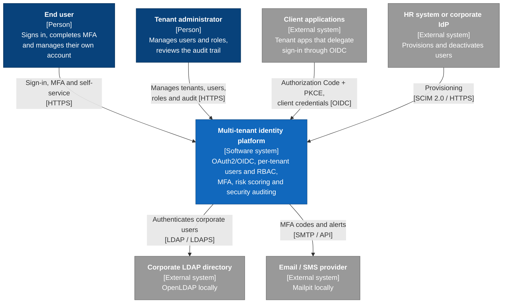

# C4 · Level 1: System Context

Who uses the platform and which external systems it talks to. Locally, external systems are simulated with containers (OpenLDAP, Mailpit and a test SCIM client).

## Notes
- **Multi-tenant:** each tenant has its own users, roles, OIDC clients and, optionally, its own LDAP directory.
- **Trust boundary:** all external traffic enters through a single entry point (the Gateway, see level 2).
- **Cloud equivalents:** see the table in the README; the diagram is the same for local, Azure and AWS.
